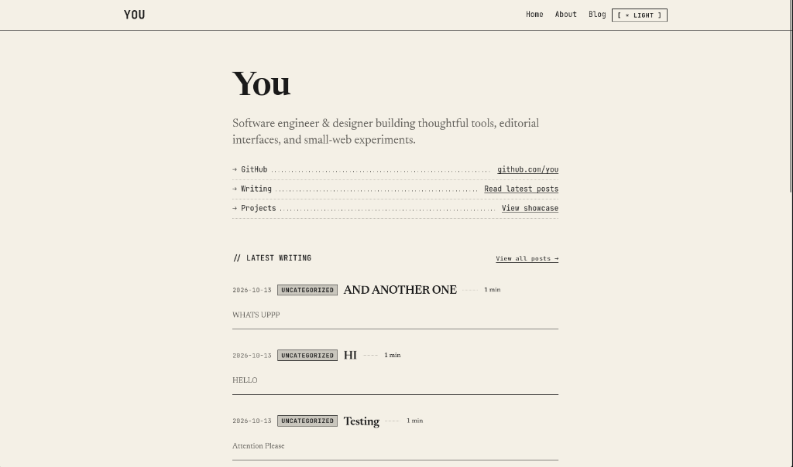

# Retro-Minimal Editorial



A reading-first WordPress block theme (Full Site Editing) paired with a companion content plugin, engineered in a restrained 90s editorial neo-brutalist aesthetic: warm cream paper, optical serif body text, monospace UI frames, 1px ink rules, and a phosphor CRT green accent.

Designed for long-form reading, project showcases, and personal hubs. Built entirely with vanilla PHP, standard HTML templates, `theme.json`, and core Gutenberg blocks—zero build steps required.

---

## Repository Layout

```text
retro-minimal-editorial/
├── theme/retro-minimal-editorial/      # WordPress Block Theme (FSE)
│   ├── style.css                       # Theme declaration
│   ├── screenshot.png                  # Theme preview screenshot (WordPress & GitHub)
│   ├── theme.json                      # Design tokens, palette, typography, layout
│   ├── functions.php                   # Theme bootstrap
│   ├── styles/dark.json                # Dark style variation (editor preview)
│   ├── assets/
│   │   ├── fonts/                      # Self-hosted Newsreader & JetBrains Mono woff2
│   │   ├── css/theme.css               # Components, window chrome, chips, dot leaders
│   │   ├── css/color-scheme.css        # Dark mode custom property overrides
│   │   └── js/editor.js                # Document setting sidebar TOC toggle
│   ├── templates/                      # index, front-page, home, single, single-project,
│   │                                   # archive, archive-project, taxonomy-project_type, page, 404
│   ├── parts/                          # header, footer, post-row, project-card
│   ├── patterns/                       # hub-intro, latest-writing, featured-projects,
│   │                                   # project-meta, link-list, category/type filters, 404
│   └── blocks/                         # reading-time, toc, theme-toggle
├── plugin/retro-minimal-core/          # Companion Content Plugin
│   ├── retro-minimal-core.php          # Plugin bootstrap & activation hooks
│   ├── includes/
│   │   ├── class-project-cpt.php       # Project post type & Type/Stack taxonomies
│   │   └── class-category-colors.php   # Term meta colors, picker, swatches & contrast guard
│   └── assets/                         # Admin color picker JS & CSS
├── dev/
│   ├── .wp-env.json                    # Local Docker environment configuration
│   └── seed.php                        # Demo content & categories seed script
└── README.md
```

---

## Key Features

1. **Reading First:**
   - 65–75 characters per line (`contentSize: 42rem` / `68ch`).
   - Newsreader variable serif with optical sizing (`opsz`) for high readability.
   - JetBrains Mono for UI metadata, dates, chips, and code blocks.
2. **Window-Chrome Project Showcase:**
   - Neo-brutalist window card styling with `{slug}.exe` title bar and decorative controls.
   - Hover transition to phosphor green title bar and `4px 4px 0 ink` offset shadow.
   - Fallback `> no preview_` with blinking cursor for projects without screenshots.
   - Full card clickability via accessible CSS stretched links.
3. **Category Color System (`retro-minimal-core`):**
   - Manage label chip colors directly inside *Posts → Categories* using WordPress's native color picker.
   - Preloaded with 9 retro swatches (Phosphor, Terminal Cyan, CRT Amber, Manila, Lavender, Bubblegum, Signal Orange, Cobalt Wash, Platinum).
   - Built-in WCAG contrast guard warns if background color falls below 4.5:1 against ink text.
   - Portable content: Projects, taxonomies, and colors survive theme switches.
4. **Dark Mode:**
   - Follows OS `prefers-color-scheme` automatically.
   - Header theme toggle button (`[ AUTO / LIGHT / DARK ]`) saves preference to `localStorage`.
   - Synchronous inline script prevents Flash of Wrong Theme (FOWT) on page reload.
5. **Table of Contents Block:**
   - Automatically parses post H2/H3 headings and renders when 3+ headings are present.
   - Active section tracking via IntersectionObserver.
   - Opt-out toggle in post editor sidebar (`rme_hide_toc`).

---

## Local Development Setup

### Option 1: Using `@wordpress/env` (Docker)

Ensure Docker is running, then run:

```bash
# Start the local environment (installs WordPress, activates theme and plugin)
npx @wordpress/env start --config=dev/.wp-env.json

# Seed demo categories, posts, and projects
npx @wordpress/env run cli wp eval-file wp-content/seed.php --config=dev/.wp-env.json
```

Default credentials:
- URL: `http://localhost:8888`
- Admin: `http://localhost:8888/wp-admin` (Username: `admin`, Password: `password`)

### Option 2: Existing Local WordPress Setup

1. Symlink or copy `theme/retro-minimal-editorial` into `wp-content/themes/`.
2. Symlink or copy `plugin/retro-minimal-core` into `wp-content/plugins/`.
3. Activate both in **wp-admin → Appearance → Themes** and **Plugins**.
4. Configure **Settings → Reading**:
   - Homepage displays: *A static page*
   - Homepage: *Home* (using the front-page hub)
   - Posts page: *Writing* (or *Blog*)
5. (Optional) Run `wp eval-file dev/seed.php` via WP-CLI to seed demo data.

---

## License

GNU General Public License v2 or later.
Fonts: Newsreader (SIL OFL) & JetBrains Mono (SIL OFL).
